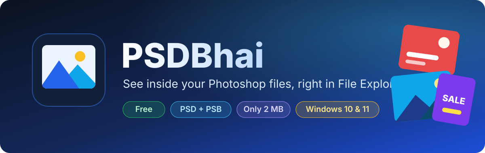
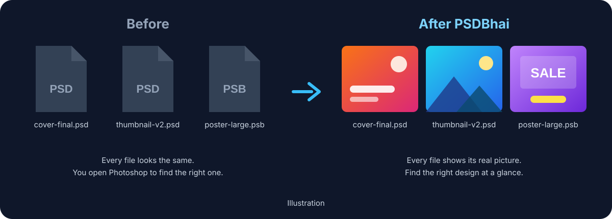

  

  
  
  
  

<h3 align="center">Stop opening Photoshop just to see what's inside a PSD.</h3>

  PSDBhai shows the real picture of every <b>.psd</b> and <b>.psb</b> file in Windows File Explorer, 
  and in every app's Open and Save windows, just like a Mac does.

  

  Free forever · No sign-up · No ads · Works offline

 

  

## ✨ Why you'll like it

| | |
| :--- | :--- |
| 🖼️ **Real previews** | See your designs as thumbnails in Medium, Large and Extra large icon views. |
| ⚡ **Fast** | A 750 MB Photoshop file gets its thumbnail in about 12 milliseconds. |
| 🪶 **Tiny** | The whole installer is about 2 MB. Nothing extra to install, Photoshop not needed. |
| 💤 **Invisible** | Nothing runs in the background. Windows uses it only when it needs a thumbnail. |
| 🛡️ **Safe** | Runs in a protected Windows process, makes no internet connections, collects no data. |
| 🎨 **Every PSD** | PSD and large PSB files, RGB, CMYK, Grayscale, Lab, 8/16/32-bit, transparency. |
| 💻 **Every PC** | Windows 10 and 11, on Intel, AMD and ARM laptops. |

## 📥 Install in 3 clicks

1. **Download** [PSDBhai-Setup.exe](https://github.com/Muhon33/PSDBhai/releases/latest/download/PSDBhai-Setup.exe).
2. **Double-click** it, tick **I accept the agreement**, then click **Install**.
3. Click **Finish**, open any folder with PSD files, and switch the view to **Large icons**.

No admin password needed.

> [!NOTE]
> **Seeing a warning?** PSDBhai is new, so Windows doesn't recognize it yet. Your browser may say the file *"isn't commonly downloaded"*: choose **Keep**. Windows may then show **"Windows protected your PC"**: click **More info**, then **Run anyway**. Microsoft Defender scans it as clean. Code signing is on the way to remove these warnings ([code signing policy](#-code-signing-policy)).

> [!TIP]
> Files you browsed before installing still show the old icon? Open **PSDBhai** from the Start menu and click **Refresh thumbnails**.

## ⚙️ Settings

Open **PSDBhai** from the Start menu:

| Option | What it does |
| :--- | :--- |
| ☑️ **Show thumbnails for .psd / .psb** | Turn previews on or off for each file type |
| 🔍 **Sharp** (recommended) | Big icons show the full, crisp image |
| 🚀 **Fast** | Always uses Photoshop's small built-in preview |
| 🔄 **Refresh thumbnails** | Clears old cached icons so new previews appear |

## 🗑️ Uninstall

**Settings** › **Apps** › **Installed apps** › **PSDBhai** › **Uninstall**. Everything is removed, and Windows goes back to how it was.

<b>For IT admins</b>

 

- Install for all users (needs admin): `PSDBhai-Setup.exe /ALLUSERS`
- Silent install: add `/VERYSILENT`
- Every version is listed on the [Releases page](https://github.com/Muhon33/PSDBhai/releases).

<b>For developers</b>

 

PSDBhai is a small native C++ Windows Shell thumbnail handler with no dependencies. Building, testing, the design and the release process are covered in the [developer guide](docs/development.md).

## 🔏 Code signing policy

Free code signing provided by [SignPath.io](https://about.signpath.io/), certificate by [SignPath Foundation](https://signpath.org/).

Release builds are produced only by the [GitHub Actions workflow](.github/workflows/build.yml) from the source code in this repository, and every signing request is approved by hand.

- Committers and reviewers: [Muhon33](https://github.com/Muhon33)
- Approvers: [Muhon33](https://github.com/Muhon33)

## 🔒 Privacy policy

This program will not transfer any information to other networked systems unless specifically requested by the user or the person installing or operating it. PSDBhai makes no network connections at all; it only reads the PSD and PSB files Windows asks it to show.

## 📄 License

[MIT](LICENSE). Third-party notices are in [THIRD-PARTY-NOTICES.txt](THIRD-PARTY-NOTICES.txt).

Photoshop is a registered trademark of Adobe Inc. PSDBhai is an independent project, not affiliated with or endorsed by Adobe.

  Made with ❤️ by <a href="https://github.com/Muhon33">Muhon33</a> · If PSDBhai saves you time, give it a ⭐

